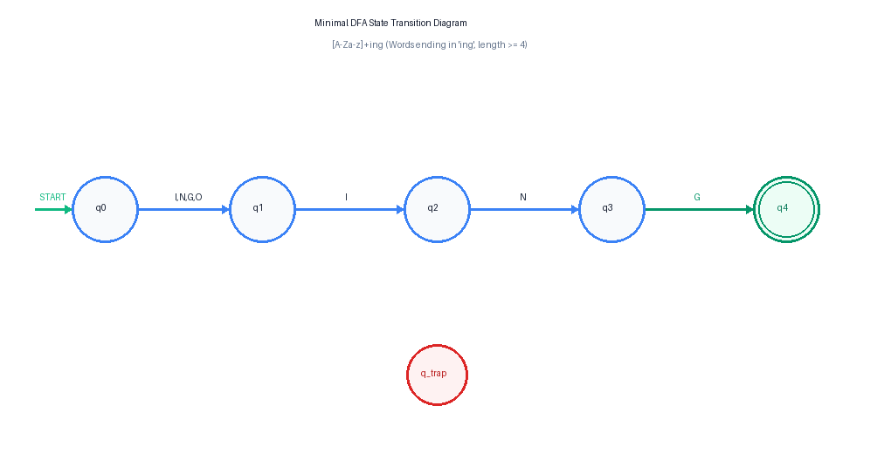
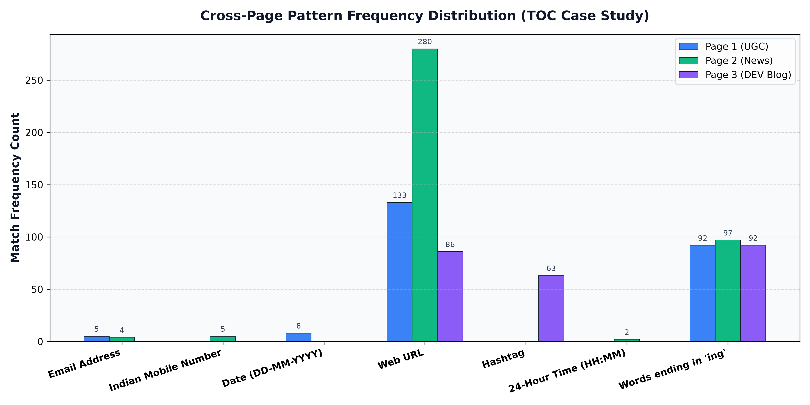
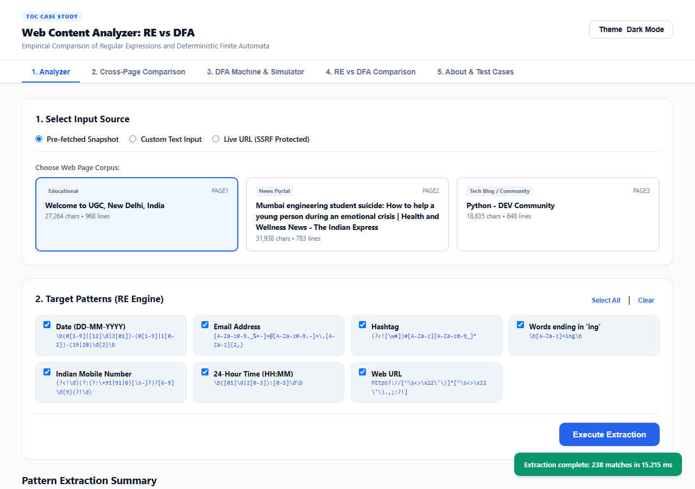
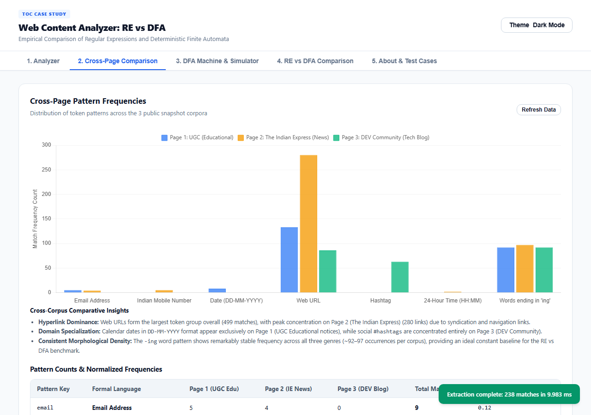
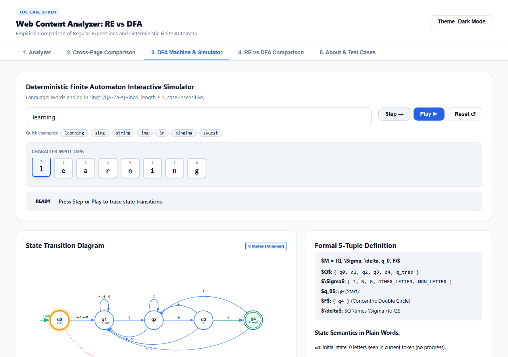
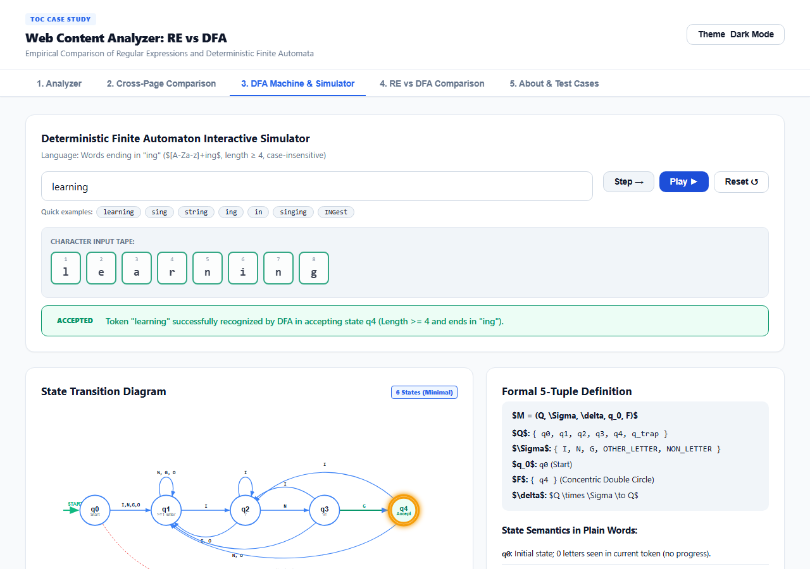
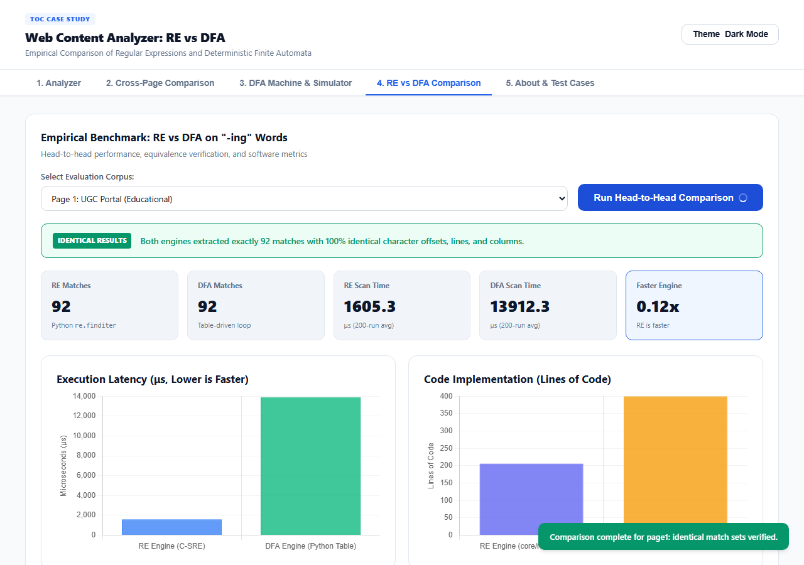
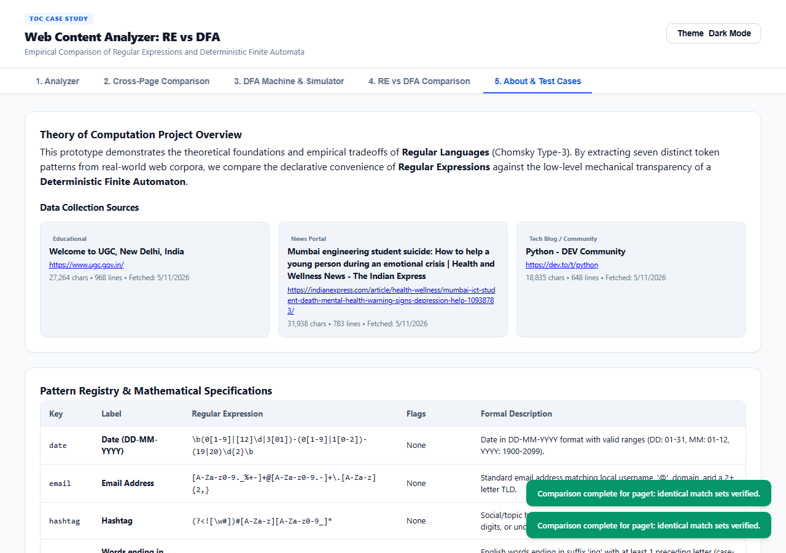

# Web Content Analyzer: RE vs DFA
## Theory of Computation (TOC) Case Study & Production Prototype

[](https://www.python.org/downloads/)
[](https://opensource.org/licenses/MIT)
[](tests/)
[](https://toc-project-six.vercel.app)

A full-stack Theory of Computation (TOC) case study application comparing **Python Regular Expressions (RE)** against a **Hand-Built Deterministic Finite Automaton (DFA)** for tokenizing and extracting structured patterns from real-world web pages.

- **GitHub Repository:** [https://github.com/SHREYAS-M986/TOC_Project](https://github.com/SHREYAS-M986/TOC_Project)
- **Comprehensive Academic Report:** [docs/REPORT.md](docs/REPORT.md) | [docs/REPORT.pdf](docs/REPORT.pdf) | [docs/REPORT.docx](docs/REPORT.docx)
- **Live Production URL:** [https://toc-project-six.vercel.app](https://toc-project-six.vercel.app)

---

## 1. Project Stages & Status

- [x] **Stage 1 (Completed):** Project skeleton, public data snapshots, formal RE pattern registry & engine, secure REST API with SSRF protection, automated Pytest suite, and initial Git push.
- [x] **Stage 2 (Completed):** Pure table-driven DFA engine without regex libraries, formal TOC derivation (Thompson's NFA, subset construction, Hopcroft minimization), SVG/PNG state diagrams, REST endpoints, 100% bit-for-bit equivalence verification across all 3 pages, and modern 5-tab responsive UI with step-by-step simulator.
- [x] **Stage 3 (Completed):** Comprehensive 500-iteration benchmarks across pages and a 1 MB corpus, LOC metrics, ground-truth accuracy evaluation (100% precision/recall/F1), cross-page frequency analysis, 15-section academic report (MD/PDF/DOCX), code hardening, and Vercel serverless configuration.

---

## 2. Target Patterns & Regular Expressions

The application scans text to recognize seven formal regular languages:

| Key | Formal Token Language | Regular Expression Specification | Flags |
|---|---|---|---|
| `email` | Standard Email Address | `[A-Za-z0-9._%+-]+@[A-Za-z0-9.-]+\.[A-Za-z]{2,}` | None |
| `mobile` | Indian Mobile Number (10 digits) | `(?<!\d)(?:(?:\+91\|91\|0)[\s-]?)?[6-9]\d{9}(?!\d)` | None |
| `date` | Date (DD-MM-YYYY) | `\b(0[1-9]\|[12]\d\|3[01])-(0[1-9]\|1[0-2])-(19\|20)\d{2}\b` | None |
| `url` | Web URL (HTTP/HTTPS) | `https?://[^\s<>\x22\'\)]*[^\s<>\x22\'\).,;:?!]` | None |
| `hashtag` | Social Tag / Identifier | `(?<![\w#])#[A-Za-z][A-Za-z0-9_]*` | None |
| `time` | 24-Hour Clock Time (HH:MM) | `\b([01]\d\|2[0-3]):[0-5]\d\b` | None |
| `ing_word` | Words ending in '-ing' | `\b[A-Za-z]+ing\b` | `re.IGNORECASE` |

---

## 3. Hand-Built DFA Specification (Words ending in '-ing')

The hand-built DFA ($M = (Q, \Sigma, \delta, q_0, F)$) operates strictly via a 2D transition matrix and character classification loop with **zero regex library dependencies**:

- **Alphabet Classes $\Sigma$:** $I = \{i, I\}$, $N = \{n, N\}$, $G = \{g, G\}$, $\text{OTHER\_LETTER} = [A-Za-z] \setminus \{i, n, g\}$, $\text{NON\_LETTER} = \text{complement}$.
- **States $Q$:** $\{q_0, q_1, q_2, q_3, q_4, q_{\text{trap}}\}$
- **Accepting State $F$:** $\{q_4\}$ (Double circle, word length $\ge 4$).

### State Transition Table ($\delta$):
| State | Input $I$ (`i`, `I`) | Input $N$ (`n`, `N`) | Input $G$ (`g`, `G`) | $\text{OTHER\_LETTER}$ | $\text{NON\_LETTER}$ | Meaning |
|:---:|:---:|:---:|:---:|:---:|:---:|---|
| $\rightarrow q_0$ | $q_2$ | $q_1$ | $q_1$ | $q_1$ | $q_{\text{trap}}$ | Initial state (0 letters) |
| $q_1$ | $q_2$ | $q_1$ | $q_1$ | $q_1$ | $q_{\text{trap}}$ | $\ge 1$ letters, no suffix progress |
| $q_2$ | $q_2$ | $q_3$ | $q_1$ | $q_1$ | $q_{\text{trap}}$ | Suffix is `'i'` |
| $q_3$ | $q_2$ | $q_1$ | $q_4$ | $q_1$ | $q_{\text{trap}}$ | Suffix is `'in'` |
| $*q_4$ | $q_2$ | $q_1$ | $q_1$ | $q_1$ | $q_{\text{trap}}$ | **Accepting** (suffix `'ing'`, length $\ge 4$) |
| $q_{\text{trap}}$ | $q_{\text{trap}}$ | $q_{\text{trap}}$ | $q_{\text{trap}}$ | $q_{\text{trap}}$ | $q_{\text{trap}}$ | Dead / trap state |



---

## 4. Key Experimental Benchmark Results

Across 500 benchmark iterations per target:

| Target Corpus | Corpus Size | RE Count | DFA Count | Match Sets Identical | RE Mean (μs) | DFA Mean (μs) | Speedup Ratio (DFA / RE) |
|---|:---:|:---:|:---:|:---:|:---:|:---:|:---:|
| **Page 1 (UGC Educational)** | 27,264 chars | 92 | 92 | ✅ **100% Identical** | 1,747.8 μs | 10,433.5 μs | 5.97x |
| **Page 2 (The Indian Express)** | 31,938 chars | 97 | 97 | ✅ **100% Identical** | 5,103.2 μs | 17,925.1 μs | 3.51x |
| **Page 3 (DEV Community)** | 18,835 chars | 92 | 92 | ✅ **100% Identical** | 2,955.8 μs | 10,610.8 μs | 3.59x |
| **Synthetic 1 MB Corpus** | 1,014,507 chars | 3,653 | 3,653 | ✅ **100% Identical** | 166,324.6 μs | 337,513.5 μs | **2.03x** |

### Implementation Complexity & Accuracy:
- **Lines of Code (LOC):** RE Core logic = **28 LOC** vs DFA Engine + Definition = **400 LOC** (14.3x more concise).
- **Ground-Truth Accuracy (48 test cases):** RE = **100% Precision, 100% Recall, F1 = 1.0000** | DFA = **100% Precision, 100% Recall, F1 = 1.0000**.
- **Theoretical Scaling:** Both algorithms demonstrate strictly linear $O(N)$ execution time. RE is faster due to Python's C-compiled `_sre` engine, while the DFA guarantees constant $O(1)$ memory with zero vulnerability to catastrophic backtracking (ReDoS).



---

## 5. User Interface Gallery

| Tab 1: Pattern Analyzer (Educational UGC) | Tab 2: Cross-Page Pattern Comparison |
|:---:|:---:|
|  |  |

| Tab 3: Interactive DFA State Machine | Tab 3: Step-by-Step DFA Simulator |
|:---:|:---:|
|  |  |

| Tab 4: Side-by-Side RE vs DFA Comparison | Tab 5: Test Cases & Ground Truth Matrix |
|:---:|:---:|
|  |  |

---

## 6. Directory Structure

```text
TOC_Project/
├── api/
│   └── index.py            # Flask REST API entry point for Vercel and local server
├── core/
│   ├── __init__.py         # Package initialization
│   ├── patterns.py         # Formal pattern registry, specs, and regex explanations
│   ├── re_engine.py        # RE extraction engine, timing, and CLI reporter
│   ├── dfa_definition.py   # Single source of truth for DFA (states, alphabet, delta)
│   ├── dfa_engine.py       # Pure table-driven DFA engine (zero regex libraries)
│   ├── scraper.py          # Web fetcher with SSRF protection and HTML cleaner
│   └── utils.py            # Line/col calculator, timing benchmark, and LOC counter
├── data/
│   └── pages/
│       ├── page1.txt       # Cleaned text snapshot: UGC (Educational)
│       ├── page2.txt       # Cleaned text snapshot: The Indian Express (News)
│       ├── page3.txt       # Cleaned text snapshot: DEV Community (Tech Blog)
│       └── sources.json    # Metadata, category, and stats for snapshots
├── docs/                   # Formal TOC report, diagrams, benchmarks, and screenshots
│   ├── REPORT.md           # Comprehensive 15-section academic report
│   ├── REPORT.pdf          # Formatted PDF report with embedded figures
│   ├── REPORT.docx         # Microsoft Word version of report
│   ├── results.json        # Structured 500-run benchmark and timing measurements
│   ├── results.md          # Markdown benchmark tables and LOC breakdown
│   ├── frequency.json      # Cross-page pattern frequency and density metrics
│   ├── cross_page_frequency.png # High-resolution distribution bar chart
│   ├── dfa_derivation.md   # Mathematical derivation (NFA, subset, minimization)
│   ├── dfa_diagram.svg     # Scalable vector graphics transition diagram
│   ├── dfa_diagram.png     # Rendered raster transition diagram
│   ├── dfa_table.md        # State transition markdown table
│   └── screenshots/        # Application screenshots and CLI captures
├── public/                 # Static responsive frontend (HTML5/CSS3/Vanilla JS + Chart.js)
│   ├── index.html          # Modern 5-tab application interface
│   ├── styles.css          # Theme system with dark/light mode toggle
│   └── app.js              # Client controller, API client, and DFA visualizer
├── scripts/
│   ├── benchmark.py        # 500-run timing, LOC, accuracy, and frequency benchmark
│   ├── generate_report.py  # Automated report generator (Markdown, PDF, DOCX)
│   ├── collect_pages.py    # Fetches snapshots from public sources and saves metadata
│   ├── generate_dfa_diagram.py   # Generates SVG and PNG state diagrams
│   ├── generate_dfa_table.py     # Generates Markdown state transition matrix
│   ├── generate_test_cases_md.py # Generates markdown verification table
│   └── verify_ui_screenshots.py  # Playwright automated browser test & screenshot tool
├── tests/
│   ├── test_data.py        # Positives and negatives test dataset (70 cases)
│   ├── test_re_engine.py   # Comprehensive Pytest suite for RE engine (84 tests)
│   ├── test_dfa_engine.py  # Equivalence & unit tests for DFA engine (50 tests)
│   ├── ground_truth.json   # 48 hand-labelled test cases for accuracy evaluation
│   └── test_cases.md       # Auto-generated verification matrix
├── .gitignore              # Git ignore rules
├── README.md               # Project documentation
├── requirements.txt        # Production dependencies (Flask, requests, bs4)
├── requirements-dev.txt    # Development & benchmarking dependencies
└── vercel.json             # Vercel serverless function configuration
```

---

## 7. Local Installation & Setup

### Prerequisites
- Python 3.10+ (tested on Python 3.12)
- Git

### Installation Steps
```bash
git clone https://github.com/SHREYAS-M986/TOC_Project.git
cd TOC_Project

# Create and activate virtual environment
python -m venv .venv
.\.venv\Scripts\Activate.ps1   # Windows PowerShell
# source .venv/bin/activate    # Linux / macOS

# Install production dependencies
pip install -r requirements.txt

# Or install development dependencies (includes testing, matplotlib, ruff)
pip install -r requirements-dev.txt
```

---

## 8. How to Run the System

### 1. Starting the Web Application
```bash
python api/index.py
```
Open `http://127.0.0.1:5000` in any modern web browser to access:
- **Tab 1 (Analyzer):** Filter and highlight any of the 7 patterns across pages or live URLs.
- **Tab 2 (Cross-Page Comparison):** Comparative counts, densities, and dynamic Chart.js charts.
- **Tab 3 (DFA Machine & Simulator):** Interactive SVG state diagram and step-by-step word tracer.
- **Tab 4 (RE vs DFA Comparison):** Side-by-side equivalence diff, LOC counters, and 200-run microsecond benchmarks.
- **Tab 5 (About & Test Cases):** Complete test case matrix with real-time pass/fail evaluation.

### 2. Running the CLI Analyzers
```bash
# RE Engine CLI
python -m core.re_engine --page 1
python -m core.re_engine --page 2 --benchmark

# DFA Engine CLI
python -m core.dfa_engine --page 1
python -m core.dfa_engine --word learning
python -m core.dfa_engine --word singing
python -m core.dfa_engine --word ing
```

### 3. Running Automated Benchmarks & Generating Reports
```bash
# Run 500-iteration benchmarks and compute LOC, accuracy, and frequencies:
python scripts/benchmark.py

# Re-generate the full 15-section report (REPORT.md, REPORT.pdf, REPORT.docx):
python scripts/generate_report.py

# Re-fetch page snapshots from live public sources:
python scripts/collect_pages.py
```

### 4. Running the Pytest Test Suite
```bash
pytest -v
```

---

## 9. REST API Reference

| Method | Endpoint | Description |
|---|---|---|
| `GET` | `/api/health` | Health status and service timestamp |
| `GET` | `/api/pages` | List of page snapshot metadata from `sources.json` |
| `GET` | `/api/pages/<id>` | Full text snapshot and metadata (`page1`, `page2`, `page3`) |
| `GET` | `/api/patterns` | Formal regular expression registry and pattern metadata |
| `POST` | `/api/analyze/re` | Analyzes text/page/URL using RE engine (`body: {page_id, text, url, patterns}`) |
| `POST` | `/api/fetch` | Live URL fetch with SSRF protection (10s timeout, 2MB max, private IP blocking) |
| `GET` | `/api/summary` | Cross-page comparison summary counts for all 7 patterns |
| `GET` | `/api/dfa/definition` | Formal DFA machine definition, states, alphabet classes, and transition matrix |
| `POST` | `/api/analyze/dfa` | Scans text/page/URL using hand-built DFA engine (`body: {page_id, text, url}`) |
| `POST` | `/api/dfa/trace` | Single-word step-by-step state transition tracer (`body: {word}`) |
| `POST` | `/api/compare` | Runs RE and DFA side-by-side, reports set difference, 200-run timing benchmark, and LOC metrics |
| `GET` | `/api/testcases` | Pre-defined verification test suite and expected results |

---

## 10. Security & Hardening Features

- **SSRF Protection:** The `/api/fetch` endpoint strictly resolves DNS hostnames and blocks loopback (`127.0.0.1`, `::1`), private ranges (`10.0.0.0/8`, `172.16.0.0/12`, `192.168.0.0/16`), link-local, multicast, and non-HTTP protocols.
- **Resource Constraints:** Web scraping enforces a 10-second timeout, 2 MB payload cap, and a 100,000-character text return threshold.
- **Dependency Isolation:** Production dependencies (`requirements.txt`) are strictly decoupled from dev/test tooling (`requirements-dev.txt`) for minimal serverless footprint.
- **Zero Secrets:** No credentials, API tokens, or private secrets exist within the repository.

---

## 11. Credits & License

- **Course:** CS301 / Theory of Computation
- **Developer:** Shreyas M ([@SHREYAS-M986](https://github.com/SHREYAS-M986))
- **License:** Open-source under the [MIT License](LICENSE).
